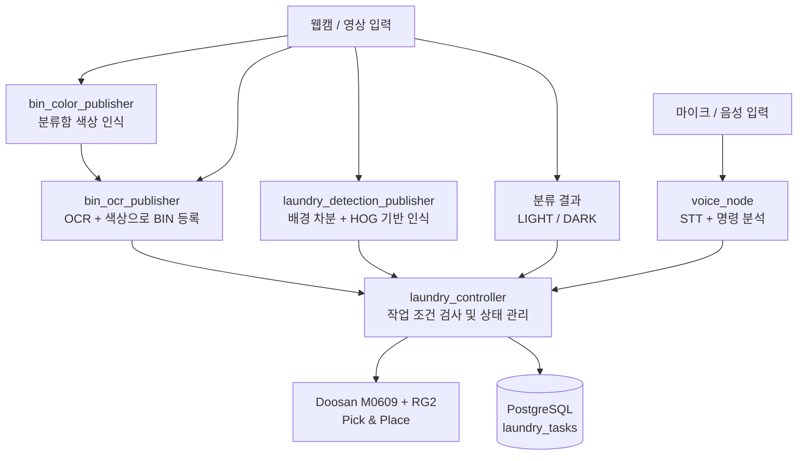
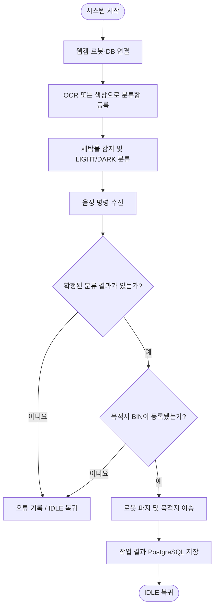

# Wash_up | ROS 2 기반 세탁물 자동 분류 로봇

> **음성 명령 → 세탁물 감지 → 밝기 분류 → 분류함 확인 → 협동로봇 이송 → DB 기록**  
> Doosan Robotics M0609 · OnRobot RG2 · ROS 2 Jazzy · OpenCV · PostgreSQL

<p align="center">
  
  
  
  
</p>

**Wash_up**은 카메라 기반 인식과 음성 명령, 협동로봇을 연결하여 세탁물을 **밝은 빨래(LIGHT)**와 **어두운 빨래(DARK)**로 분류하고 각 분류함으로 이송하도록 구성한 ROS 2 프로젝트입니다. 분류 결과와 작업 명령, 목적지, 처리 상태는 PostgreSQL에 기록합니다.

> **시연 이미지 추가 위치:** 실제 로봇 작업 사진이나 GIF를 `docs/images/washup_demo.gif`로 업로드한 후 아래 주석을 해제하세요. 현재 저장소에는 해당 경로의 파일이 확인되지 않아 깨진 이미지를 표시하지 않도록 했습니다.
>
> `<!--  -->`

---

## 목차

1. [프로젝트 개요](#1-프로젝트-개요)
2. [시스템 아키텍처](#2-시스템-아키텍처)
3. [작업 처리 흐름](#3-작업-처리-흐름)
4. [주요 기능과 구현](#4-주요-기능과-구현)
5. [ROS 2 노드 및 토픽](#5-ros-2-노드-및-토픽)
6. [기술 스택 및 장비](#6-기술-스택-및-장비)
7. [저장소 구조](#7-저장소-구조)
8. [설치 및 실행](#8-설치-및-실행)
9. [데이터베이스](#9-데이터베이스)
10. [설계 고려사항과 확인할 사항](#10-설계-고려사항과-확인할-사항)

## 1. 프로젝트 개요

| 항목 | 내용 |
| --- | --- |
| 프로젝트 | Wash_up |
| 목적 | 영상 분석과 음성 명령을 활용한 세탁물 분류 및 협동로봇 이송 |
| 분류 기준 | `LIGHT` / `DARK` |
| 분류 목적지 | `BIN_A` / `BIN_B` |
| 로봇 | Doosan Robotics M0609 |
| 그리퍼 | OnRobot RG2 |
| 주요 소프트웨어 | ROS 2 Jazzy, Python, OpenCV, PostgreSQL |
| 저장소 | [`gmltjd0725-hue/Wash_up`](https://github.com/gmltjd0725-hue/Wash_up) |

이 프로젝트는 개별 기능을 실행하는 것뿐 아니라 **인식 결과를 실제 로봇의 작업 조건과 연결**하도록 설계했습니다. 분류함이 확인되지 않거나 분류 결과가 준비되지 않으면 작업을 중단하도록 하는 조건 검사도 포함되어 있습니다.

## 2. 시스템 아키텍처



**구현 구분:** `laundry_sorting`과 `voice_processing`은 ROS 2 패키지입니다. 저장소에는 별도로 `yolo_container`가 있지만, 현재 통합 실행 스크립트의 기본 세탁물 감지 노드는 OpenCV 배경 차분과 HOG를 사용합니다. 따라서 YOLOv8을 기본 분류 경로의 필수 구성 요소로 표시하지 않았습니다.

## 3. 작업 처리 흐름



- **LIGHT → `BIN_A`**, **DARK → `BIN_B`**
- 분류함 등록 규칙: OCR에서 `A`를 확인하거나 `LIGHT_PINK` 색상을 확인하면 `BIN_A`로 등록합니다. `B` 또는 `BROWN`은 `BIN_B`에 대응합니다.
- OCR·색상 입력은 각각 연속 확인 횟수를 적용하여 단발성 감지에만 의존하지 않도록 처리합니다.
- 컨트롤러는 확정 분류 결과와 목적지 등록 여부를 검사한 뒤 로봇 작업을 호출합니다.

## 4. 주요 기능과 구현

| 기능 | 구현 방식 | 관련 코드 |
| --- | --- | --- |
| 웹캠 영상 발행 | ROS 2 `sensor_msgs/Image` 발행 | [`webcam_publisher.py`](project_ws/src/cobot2/laundry_sorting/laundry_sorting/webcam_publisher.py) |
| 세탁물 영역 검출 | 배경 프레임 30장 평균, 배경 차분, HOG 사람 후보 필터링 및 외곽선 탐색 | [`laundry_detection_publisher.py`](project_ws/src/cobot2/laundry_sorting/laundry_sorting/laundry_detection_publisher.py) |
| 색상 기반 분류 | HSV 채도(S)·명도(V) 관련 분류 및 결과 전달 | [`hsv_classifier.py`](project_ws/src/cobot2/laundry_sorting/laundry_sorting/hsv_classifier.py) |
| 분류함 식별 | Tesseract OCR 및 색상 확인을 통한 `BIN_A`/`BIN_B` 등록 | [`bin_ocr_publisher.py`](project_ws/src/cobot2/laundry_sorting/laundry_sorting/bin_ocr_publisher.py) |
| 음성 명령 | 마이크 입력, STT, 명령 문자열 유사도 검사, 의도 분석 | [`voice_node.py`](project_ws/src/cobot2/voice_processing/voice_processing/voice_node.py) |
| 작업 제어 | 분류 결과 확인 → 목적지 매칭 → 로봇 동작 → DB 저장 | [`laundry_controller.py`](project_ws/src/cobot2/laundry_sorting/laundry_sorting/laundry_controller.py) |
| 작업 기록 | 작업 명령·분류·목적지·상태 저장 | [`database.py`](project_ws/src/cobot2/laundry_sorting/laundry_sorting/database.py) |
| 별도 객체 감지 실험 | YOLO용 ROS 2 컨테이너 구성 | [`yolo_container/`](project_ws/yolo_container) |

### 4-1. 세탁물 감지

초기 카메라 프레임을 배경으로 저장하고 새 영상과의 차이를 분석합니다. 형태학적 연산으로 마스크를 정리한 뒤 객체 외곽선을 선택합니다. 사람을 세탁물로 잘못 인식하지 않도록 HOG 사람 후보와 피부색 정보를 함께 사용합니다.

### 4-2. 분류함 인식

분류함 라벨의 **OCR 인식 결과**와 분류함 **색상 정보**를 결합합니다. 인식 결과와 등록 근거(`OCR`, `COLOR`)를 관리하고 등록된 분류함 정보를 ROS 2 토픽으로 전송합니다.

### 4-3. 음성 명령

현재 `voice_node.py`는 STT 텍스트를 정규화하고, **“밝은 빨래와 어두운 빨래를 구분해줘”**라는 명령과의 문자열 유사도를 검사합니다. 유사도가 기준 이상일 때 `SORT_LAUNDRY` 의도에 해당하는 명령을 발행합니다.

> **현재 코드 기준:** 음성 노드 로그에는 `Wake Word 사용 안 함`이 명시되어 있습니다. 시작 스크립트에 호출어 안내가 남아 있더라도 실제 동작은 현재 음성 노드 구현을 기준으로 확인해야 합니다.

### 4-4. 로봇 제어 및 기록

컨트롤러는 분류 결과가 없거나 목적지 분류함 정보가 없을 때 작업을 진행하지 않습니다. 이송 이후 결과를 `laundry_tasks` 테이블에 기록하고 상태를 `IDLE`로 복귀시킵니다.

## 5. ROS 2 노드 및 토픽

| 토픽 | 메시지 | 주요 역할 |
| --- | --- | --- |
| `/webcam/image_raw` | `sensor_msgs/msg/Image` | 카메라 이미지 입력 |
| `/laundry/bin_color_detections` | `std_msgs/msg/String` | 분류함 색상 감지 결과 |
| `/laundry/bin_detections` | `std_msgs/msg/String` | 등록된 분류함 및 인식 근거 |
| `/laundry/detections` | `std_msgs/msg/String` | 세탁물 바운딩 박스 등 감지 결과 |
| `/laundry/classification_ready` | `std_msgs/msg/String` | 확정된 `LIGHT`/`DARK` 분류 결과 |
| `/voice/command` | `std_msgs/msg/String` | 음성 명령의 JSON 데이터 |

`String` 토픽 일부는 JSON 직렬화 데이터를 전달합니다. 메시지 형식과 발행 시점은 각 노드 소스코드에 정의되어 있습니다.

## 6. 기술 스택 및 장비

| 영역 | 기술 / 장비 | 용도 |
| --- | --- | --- |
| 로봇 미들웨어 | ROS 2 Jazzy, `rclpy` | 노드 간 통신 및 제어 |
| 프로그래밍 | Python | 인식·제어 로직 |
| 영상 처리 | OpenCV, NumPy | 전처리, 배경 차분, HSV, HOG |
| 문자 인식 | Tesseract / `pytesseract` | 분류함 OCR |
| 음성 | STT, PyAudio | 음성 입력과 명령 처리 |
| 데이터베이스 | PostgreSQL, `psycopg2` | 작업 이력 기록 |
| 로봇 | Doosan M0609 | 실제 로봇 파지·이송 |
| 그리퍼 | OnRobot RG2 | 세탁물 파지 |
| 별도 실험 구성 | Docker, Ultralytics | YOLO 객체 검출 컨테이너 |

## 7. 저장소 구조

현재 GitHub에 올라온 **실제 경로**를 중심으로 정리했습니다.

```text
Wash_up/
└── project_ws/
    ├── src/
    │   └── cobot2/
    │       ├── laundry_sorting/
    │       │   ├── config/
    │       │   ├── launch/
    │       │   ├── laundry_sorting/
    │       │   │   ├── laundry_controller.py
    │       │   │   ├── laundry_detection_publisher.py
    │       │   │   ├── bin_ocr_publisher.py
    │       │   │   ├── bin_color_publisher.py
    │       │   │   ├── hsv_classifier.py
    │       │   │   └── database.py
    │       │   └── sql/schema.sql
    │       └── voice_processing/
    │           └── voice_processing/
    │               ├── voice_node.py
    │               ├── stt.py
    │               └── command_parser.py
    ├── yolo_container/
    │   ├── Dockerfile
    │   ├── requirements.txt
    │   └── object_detection/
    ├── laundry_project/
    ├── start_laundry_system.sh
    └── voice_gui_clean.sh
```

> 저장소에는 `build/`, `install/`, `log/`, 과거 코드 백업 파일과 데이터셋도 포함되어 있습니다. 위 구조는 이해를 돕기 위해 주요 소스만 나타낸 것이며, 실제 저장소의 전체 목록은 아닙니다.

## 8. 설치 및 실행

### 8-1. 실행 전 준비

- Ubuntu 및 **ROS 2 Jazzy** 환경
- Doosan M0609과 RG2에 필요한 드라이버·Bringup 환경
- 카메라 및 마이크
- PostgreSQL 서버와 `laundry_db` 데이터베이스
- 필요한 Python/ROS 패키지 (OpenCV, `cv_bridge`, `psycopg2`, `pytesseract`, PyAudio 등)
- 실제 로봇 구동 시 안전 구역 확보, 로봇 제어권 및 비상 정지 상태 확인

**주의:** 통합 실행 스크립트는 작성 당시 개발 PC의 절대 경로인 `~/ws_cobot_pjt/ws_dsr`와 `~/project_ws`를 사용합니다. 새 PC 또는 GitHub에서 복제한 경로에서는 스크립트의 `source` 경로를 먼저 수정해야 합니다. 또한 로봇 IP `192.168.1.100`은 코드에 설정된 예시 환경값이며 실제 장비 설정과 일치하는지 확인해야 합니다.

### 8-2. 소스 내려받기와 빌드

```bash
git clone https://github.com/gmltjd0725-hue/Wash_up.git
cd Wash_up/project_ws

source /opt/ros/jazzy/setup.bash
colcon build --symlink-install
source install/setup.bash
```

### 8-3. 데이터베이스 테이블 생성

먼저 `laundry_db` 데이터베이스와 접속 계정을 준비한 후 아래 SQL 스키마를 적용합니다.

```bash
cd Wash_up/project_ws
psql -h localhost -U postgres -d laundry_db \
  -f src/cobot2/laundry_sorting/sql/schema.sql
```

`DB_PASSWORD` 등 접속 정보는 환경에 맞게 설정하세요. 비밀번호를 GitHub에 올리지 마세요.

### 8-4. 통합 실행

로봇 드라이버와 데이터베이스 설정을 마친 뒤, **스크립트 내부 환경 경로를 수정한 상태에서** 실행합니다.

```bash
cd Wash_up/project_ws
chmod +x start_laundry_system.sh
./start_laundry_system.sh
```

분류함 OCR 확인 창도 함께 보려면 다음 옵션을 사용합니다.

```bash
cd Wash_up/project_ws
./start_laundry_system.sh --viewer
```

스크립트의 주요 실행 순서:

1. M0609 실제 로봇 Bringup
2. 웹캠 영상 발행
3. 분류함 색상 감지
4. 세탁물 감지
5. 작업 컨트롤러
6. 분류함 OCR 및 색상 등록
7. 음성 명령 노드
8. 선택적 OCR 뷰어

> 이 실행법은 저장소에 있는 스크립트를 설명한 것으로, 다른 PC에서의 재현 실행을 검증한 설치 가이드는 아닙니다.

## 9. 데이터베이스

테이블명: **`laundry_tasks`**

| 컬럼 | 용도 |
| --- | --- |
| `id` | 작업 기록 ID |
| `command` | 입력 명령 |
| `target` | 작업 대상 |
| `confidence` | 기록된 분류 신뢰도 필드 |
| `saturation`, `value` | HSV 분류 입력값 |
| `classification` | `LIGHT` 또는 `DARK` |
| `destination` | `BIN_A` 또는 `BIN_B` |
| `status` | 작업 처리 상태 |
| `created_at` | 기록 시각 |

> 소스코드에서 확정 분류 결과의 `confidence`에 `1.0`을 지정하는 부분이 있습니다. 이를 별도의 실측 모델 정확도로 해석하지 않아야 합니다.

## 10. 설계 고려사항과 확인할 사항

### 코드로 확인한 설계 포인트

- **작업 조건 확인:** 분류 결과나 목적지 정보가 없을 경우 로봇 작업을 진행하지 않습니다.
- **중복 인식 완화:** 분류함 OCR 및 색상 결과에 연속 확인 규칙을 사용합니다.
- **인식과 제어 분리:** 카메라/분류함/음성 노드의 정보를 컨트롤러가 종합합니다.
- **실행 자동화:** 실행 스크립트가 DB 연결을 확인하고 주요 노드를 순차 기동합니다.
- **이력 기록:** 작업 명령, 분류값, 목적지, 상태를 PostgreSQL에 저장합니다.

### 공개 전 검증이 필요한 항목

- [ ] 실제 로봇 작업 사진 또는 짧은 시연 GIF 추가
- [ ] 정상 시나리오의 검증 결과 및 실패 사례 기록
- [ ] 각도/좌표, 정지 조건, 작업 범위 등 로봇 안전 조건 문서화
- [ ] 개발 PC에 고정된 ROS 환경 경로와 로봇 IP 분리
- [ ] 통합 실행 스크립트의 호출어 안내와 실제 음성 노드 동작 일치 여부 점검
- [ ] 환경변수 및 자격증명 점검 후 민감정보 제거
- [ ] 불필요한 `build/`, `install/`, `log/` 및 백업 파일 Git 추적 여부 정리
- [ ] 성능 지표를 측정한 경우에만 성공률·정확도·작업시간 기재

---

### Source Code

**Repository:** [github.com/gmltjd0725-hue/Wash_up](https://github.com/gmltjd0725-hue/Wash_up)

이 README는 저장소의 실제 ROS 2 패키지, 노드, 통합 실행 스크립트, SQL 스키마를 기준으로 작성되었습니다. 시연 이미지와 실측 성능은 별도 자료가 확인된 뒤 추가할 수 있습니다.
